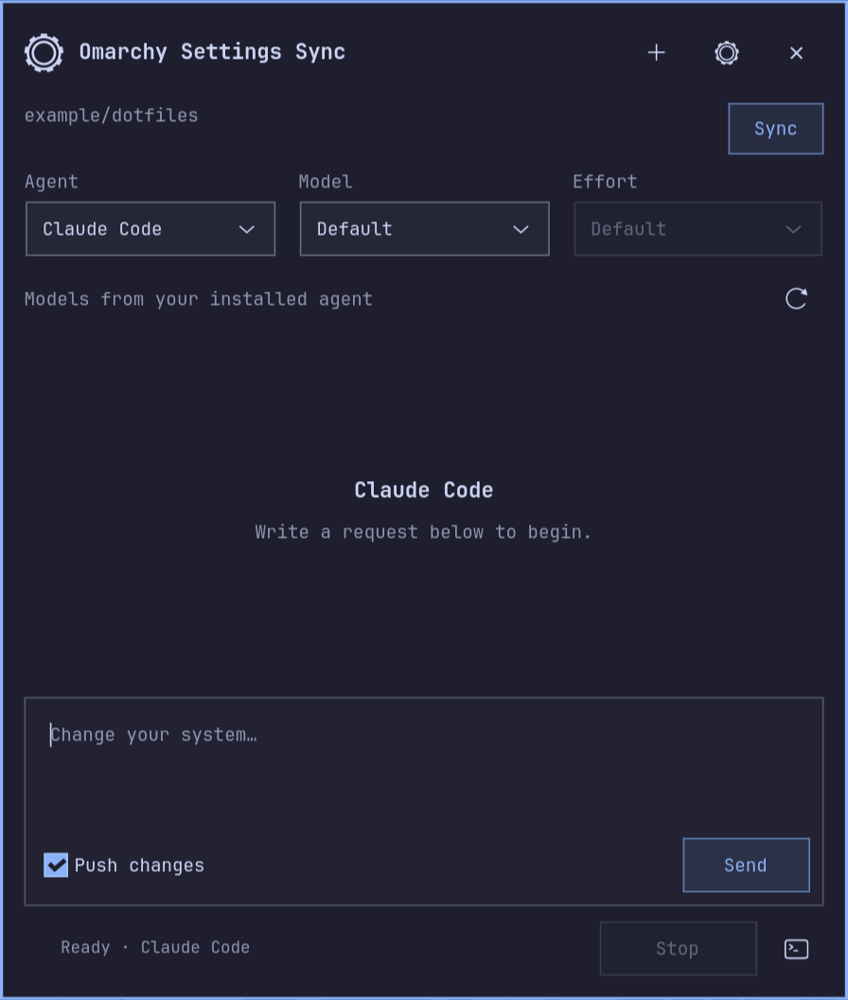
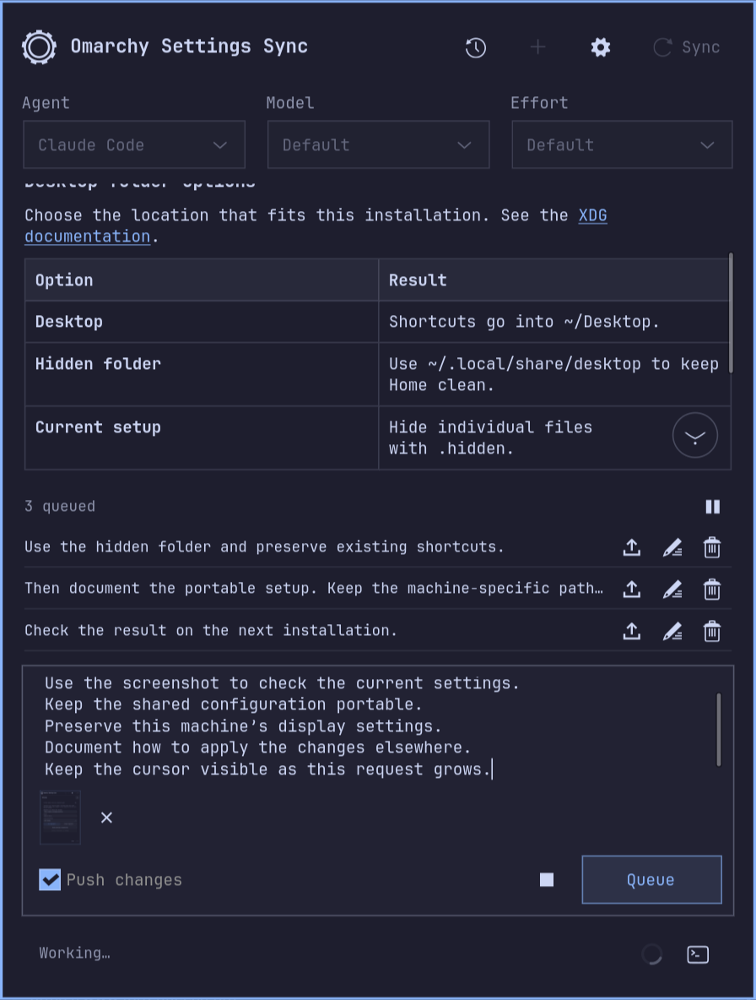
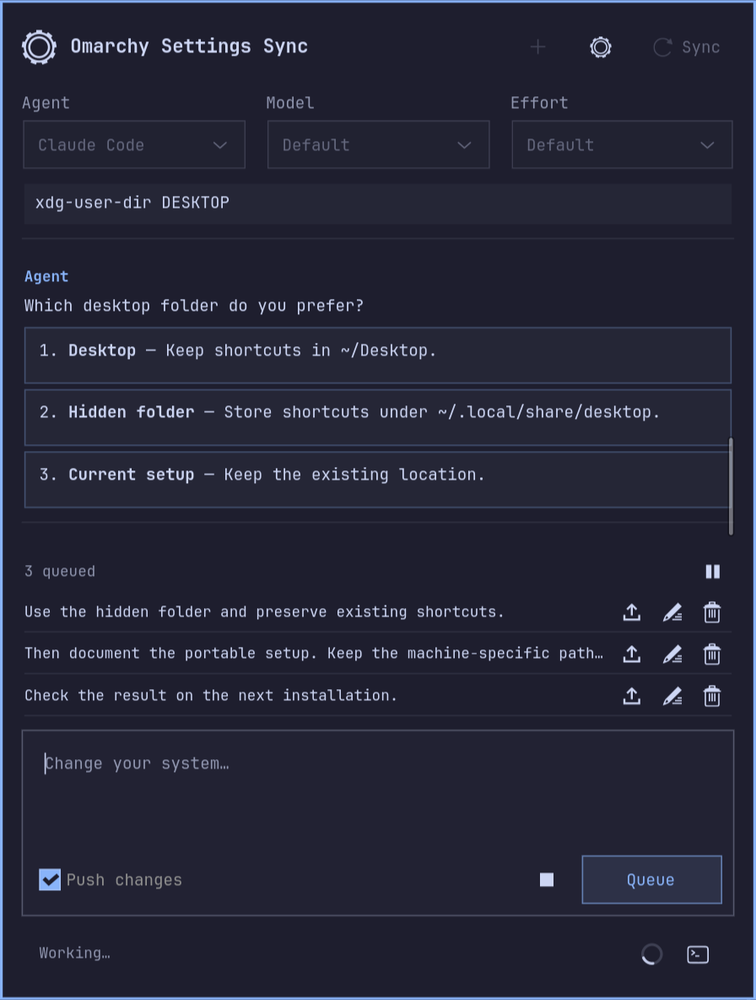
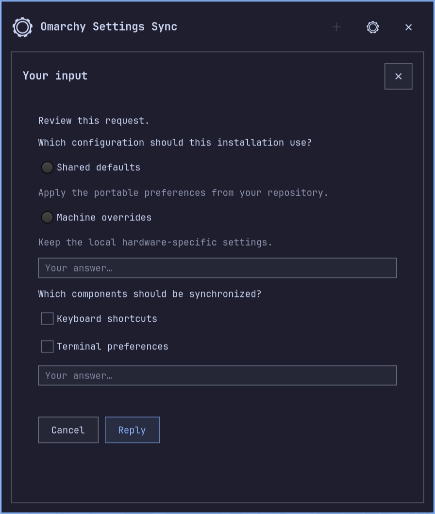
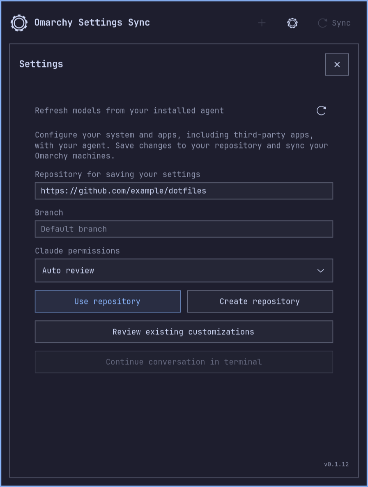

# Omarchy Settings Sync

**Configure your system and apps with your agent. Sync your Omarchy machines.**

Describe a change to the system, an Omarchy app or a third-party app. Your local
agent configures this machine and, with **Push changes** enabled, saves reusable
settings in your own Git repository. On another Omarchy machine, select the same repository and click
**Sync** to apply them. Your configuration repository stays separate from the
plugin's source code.

Already customized your system or apps? **[Settings](docs/settings.png) → Review existing
customizations** asks the agent to find portable changes and lets you choose
what to save.

<p align="center"></p>

<details>
<summary>More screenshots</summary>

Examples use synthetic data.

| Conversation and queue | Clickable answers |
| --- | --- |
| [](docs/conversation.png) | [](docs/choices.png) |

| Structured questions | Settings |
| --- | --- |
| [](docs/questions.png) | [](docs/settings.png) |

</details>

## Sync between installations

1. **On your first installation**, install the plugin and select your existing
   configuration repository. If you do not have one, enter its intended
   `owner/name` or URL and use **Create repository** to ask the selected agent
   to prepare a private repository from portable preferences. The address is
   saved in Settings before creation; if creation fails, it stays configured
   for retrying. The panel does not discover a different URL from the reply.
2. **Save reusable changes** there. Describe what to configure in the panel and
   enable **Push changes** when you want the agent to update that repository.
3. **On another Omarchy installation**, install the plugin, authenticate your
   chosen agent and Git account, and select the same repository and branch.
4. Click **Sync**. The agent compares the repository with that installation,
   preserves local changes, adapts hardware-specific settings, and applies and
   tests compatible components. Repeat Sync when you want to receive updates.

This is an agent-assisted, on-demand workflow. It does not continuously mirror
files or run a background sync daemon. The [sync workflow](plugin/WORKFLOW.md)
instructs the agent to make backups, resolve conflicts with you and record the
result; the panel itself is not a deterministic configuration manager.

## Requirements

- Omarchy Quattro with its plugin-enabled Quickshell bar and a Hyprland Wayland session.
  Tested on Omarchy 4.0.5-1.
- Python 3.11 or newer; Arch packages `python-gobject`, `gtk4`, `vte4` and
  `gtk4-layer-shell` for the panel and embedded terminal.
- `xdg-terminal-exec` for opening a workspace terminal; `hyprctl` for monitor
  and theme integration. These are part of the tested Omarchy setup.
- At least one supported agent CLI, installed and authenticated separately.
  The plugin does not include a model, provider account or agent subscription.
- Git access to your configuration repository. GitHub CLI (`gh`) is useful for
  authentication and repository creation. `mise` is used to resolve Omarchy's
  agent launchers when present.

For a private GitHub configuration repository, set up authentication using
`gh auth login` and `gh auth setup-git`, or your usual SSH configuration.

## Install

```sh
omarchy plugin add https://github.com/JohanKRS/omarchy-settings-sync.git --enable
```

Open the settings icon in the bar. On first launch, missing GTK dependencies
are installed through `omarchy pkg add` in a visible terminal; the package
manager may request your administrator password. Agent CLIs are installed
separately through Omarchy's agent menu.

Enter a configuration repository as `owner/repository`, an HTTPS URL or an SSH
URL. An empty branch uses the repository's default branch. See the
[configuration repository guide](docs/CONFIGURATION.md) for a portable layout.

## Use the panel

| Control | Behavior |
| --- | --- |
| Settings icon, left click | Open or hide the panel; reveal a pending question |
| Settings icon, right click | No action |
| **Sync** | Ask the agent to sync the configured repository onto this installation |
| Message field | Request a specific change; optionally publish its reusable configuration |
| **Enter / Send / Queue** | The same button sends when idle and queues while an agent is working |
| Queue above the message field | Compact one-line previews with **Direct now / Send now**, **Edit** and **Remove** icons; pause/resume beside the count |
| **Ctrl+Enter** during native work | Steer Codex's current turn; interrupt and continue Claude in the same conversation |
| Alternatives in a Codex/Claude conversation | Click an option to answer immediately, preserving the composer draft and queued messages |
| **Copy request** for an external agent | Copy the initial request and context; paste into the CLI's message input and send |
| **Copy to terminal** on a queued external message, or **Ctrl+Enter** | Copy a follow-up; paste into the agent input and use that CLI's send/queue controls |
| **Push changes** | Authorize the agent to publish reusable changes to your configuration repository after validation; enabled by default |
| Agent, model, effort | Choose before starting; selections are remembered per agent |
| **?** in the bar | Codex or Claude is waiting for an answer or permission |
| Stop icon, beside Send/Queue while working | Interrupt a native conversation, or send Ctrl+C to an embedded CLI |
| Terminal icon | Open a companion shell in the workspace, including during a task |
| Settings | Configure the repository and permissions; inspect or refresh the installed agent's models |
| **Settings → Review existing customizations** | Find portable system and app settings already on this machine and choose what to save to the configured repository |
| **Continue conversation in terminal** | Resume an idle Codex/Claude conversation in its CLI |
| New chat | Archive the current local conversation and start a fresh one |
| Down arrow in the conversation | Shown while reading older messages; jump to the latest message and resume following replies |

Escape closes the topmost question, settings panel or selector first. When an
embedded terminal has focus, Escape goes to the CLI for its own controls.
Otherwise, Escape or a click outside hides the panel. Hiding an active task does not stop it.
The default prompt asks Codex and Claude to use native structured questions,
with clickable options and free text; Claude also supports multiple selections.
Codex's question tool is enabled in normal execution for plugin threads.
In the native conversation, explicit choice questions with numbered, bulleted
or A)/B) alternatives become clickable after the message finishes streaming.
The latest agent message can be answered once this way: the question and full
selected alternative are sent immediately, using the existing direction flow
while working or a new turn in the same conversation when idle. Detection uses
explicit selection language in English, Portuguese or Spanish; ordinary lists,
code, quotes and checklists stay text. You can always answer in the message field.
Structured question and permission dialogs retain their existing controls.
See the [clickable conversation choices](docs/choices.png).
Shift+Enter inserts a newline in the panel's message field.
The conversation follows newly laid-out text without clipping the final line,
and stops following when you scroll up to read. Scrolling past an edge moves
the text slightly and springs back, without the GTK edge glow. The animation
respects the desktop's reduced-motion setting.

Messages render Markdown tables, clickable links, headings, lists, checklists,
quotes, bold/italic/strikethrough text and code. Tables wrap their cells and wide
tables scroll horizontally inside the conversation. Basic inline HTML formatting
(such as `b`, `em`, `code`, `a` and `br`) is supported; other HTML is displayed as
text. Images appear as links with their alternative text. Content does not run
HTML scripts or fetch remote images. The panel is slightly taller, up to the
available monitor height. The activity indicator is shown only during work and
resumes animating when the panel is reopened; it does not show a percentage.
See the [conversation and queue preview](docs/conversation.png).

Follow-ups are saved locally per agent, repository, branch and conversation.
**Stop**, a failed task or a disconnected client pauses automatic sending.
After reopening the application, use **Resume queue** beside the inline count to continue.
If delivery was not confirmed, review the conversation before editing and
retrying that message. Editing preserves an existing composer draft; clear or
queue the draft first. Send or remove pending messages before starting a new
chat or changing repositories.
Editing moves the queued text and its publication choice back into the main
message field. The queue is hidden when empty and scrolls within a limited
height when several messages are pending. Hover over a preview to read the full
message and its publication choice; warning icons flag unconfirmed delivery or
messages from another conversation.

All supported agents have the local queue. Codex and Claude have automatic
dispatch because their native connections report response boundaries. Other
agents run inside a terminal: use **Copy to terminal**, paste with Ctrl+Shift+V
into the agent's message input, then use its own send, queue or interrupt keys.
The copied message stays in the panel queue until you remove it. The panel
cannot detect those CLIs' response boundaries and does not automatically type
messages or press Enter into a terminal that might be asking for permission.
Their native support for mid-response messages varies by CLI and version.

External agents also start without the initial request in their command-line
arguments. Use **Copy request**, then paste into the agent's message input and
send when it is ready. This applies to the embedded and standalone terminal.
The complete request stays in panel memory until you change agents, start a new
chat or close the application; copying uses the desktop clipboard, which may be
retained by your clipboard manager. The panel does not automatically paste or
submit it. Native Codex and Claude keep their direct stdin-based delivery.

## Agent support

| Agent | Conversation | Models and effort | Validation |
| --- | --- | --- | --- |
| Codex | Native `app-server --stdio`; questions, approvals, resume and interrupt | Local cache, refreshed from the connected CLI | CLI 0.163.0; protocol and live checks |
| Claude Code | Native bidirectional `stream-json`; `AskUserQuestion`, tool permissions, resume and interrupt | Installed CLI metadata; per-model effort; six-hour cache | CLI 2.1.302; live structured question roundtrip |
| OpenCode | Embedded CLI | `models --verbose`, including effort variants | Adapter fixtures; live account testing pending |
| Cursor CLI | Embedded CLI | `--list-models`; effort stays with the CLI | Adapter fixtures; live account testing pending |
| Gemini, Copilot, Crush, Grok, Hermes, Muse Code, Oh My Pi, OpenClaw, Pi | Embedded CLI | Default/custom model where the CLI accepts it; otherwise use its own controls | Launch adapters; live account testing pending |

Codex and Claude use your local CLI login, skills and MCP configuration. They do
not inherit connections exclusive to another app. Codex defaults to
`workspace-write` with automatic approval review; manual approval and read-only
modes are available. Claude has its own permission selector: auto review,
ask for approval, accept edits or plan mode. Choices are saved separately for
each native agent and take effect on the next request, including a resumed
conversation or terminal handoff. Existing Claude configurations keep `auto`
until changed. Plan mode prepares a plan; it is not a filesystem sandbox. Other CLIs
keep their own permission interfaces, and their questions do not set the bar's
question indicator. See [security and data handling](SECURITY.md).

The interface supports English, Portuguese and Spanish. Documentation is in
English. Theme colors, font and control styling follow the active Omarchy theme;
[compatibility notes](docs/COMPATIBILITY.md) describe the GTK panel's differences
from a native QML panel.

## Update, disable and remove

```sh
omarchy plugin update community.agent-settings
omarchy plugin disable community.agent-settings
omarchy plugin enable community.agent-settings
omarchy plugin remove community.agent-settings
```

Finish or stop active work before updating or removing the plugin. Updates use
the repository's default branch through Omarchy's normal updater; no agent is
needed. Local edits in the installed checkout can prevent a fast-forward update.
Disabling the bar widget hides its panel; active tasks are preserved.
For predictable shutdown, finish them first. Removal preserves your configuration
repository and local plugin data.

The display name and repository are now **Omarchy Settings Sync**. The permanent
plugin ID (`community.agent-settings`) and existing data paths are retained, so
renaming does not reset your settings or conversations.

New native Codex and Claude Code conversations appear in the agent's history as
**Settings Sync · <your first request>**. Names are shortened locally, without
an extra model call, and stay unchanged on follow-ups or resume. Search for
**Settings Sync** or the topic in your agent's history. Existing conversations
keep their names. Local archives also include the topic and agent in their
filenames. Other CLIs keep their own naming behavior.

| Default location | Contents |
| --- | --- |
| `~/.config/omarchy-agent-settings/settings.json` | Repository, branch, selections, conversation IDs and names |
| `~/.local/state/omarchy-agent-settings/` | Conversations, activity records, logs, model cache and backups |
| `~/.local/state/omarchy-agent-settings/outbox.json` | Unsent follow-ups, including messages with unconfirmed delivery |
| `~/.local/share/omarchy-agent-settings/workspace/` | Working copies of configuration repositories |

The corresponding `XDG_CONFIG_HOME`, `XDG_STATE_HOME` and `XDG_DATA_HOME` overrides
are supported. These files are not part of the plugin repository. Your agent
may send prompts and relevant configuration content to its configured provider
and MCP services; the plugin adds no telemetry or separate hosted service.

## Opening performance

The panel keeps its idle interface ready for up to 60 seconds after closing.
Reopening uses a small D-Bus call; it does not reload Python or GTK. Idle agent
connections close separately, theme polling pauses while hidden, and the embedded
terminal loads only when an external CLI needs it. Active tasks and questions
remain available until you finish them.

On the tested desktop, five samples measured a median **293 ms** for a fresh
application and **14 ms** for a cached reopen to the first frame. These are local
measurements, not timing guarantees; see [performance notes](docs/PERFORMANCE.md)
for the method and limits.

## Contribute and report issues

See [CONTRIBUTING.md](CONTRIBUTING.md) for automated and visual tests,
[CHANGELOG.md](CHANGELOG.md) for changes, and
[SECURITY.md](SECURITY.md) for sensitive reports. Ordinary bugs can be reported
through [GitHub issues](https://github.com/JohanKRS/omarchy-settings-sync/issues).
Screenshots use an example repository and contain no personal configuration.

[MIT license](LICENSE). The bundled [Mistune parser](plugin/_vendor/README.md)
uses the BSD-3-Clause license. Independent community project; not an official Omarchy,
OpenAI or Anthropic product.
